# 와글와글 화면 캡처

포트폴리오·README·발표 자료에서 재사용할 수 있도록 목업 API 기준의 주요 사용자 흐름을 390×844 모바일 화면으로 개별 캡처한 자료.

## 1. 로그인·온보딩

| 로그인 | 기본 정보 | 닉네임 |
|---|---|---|
| 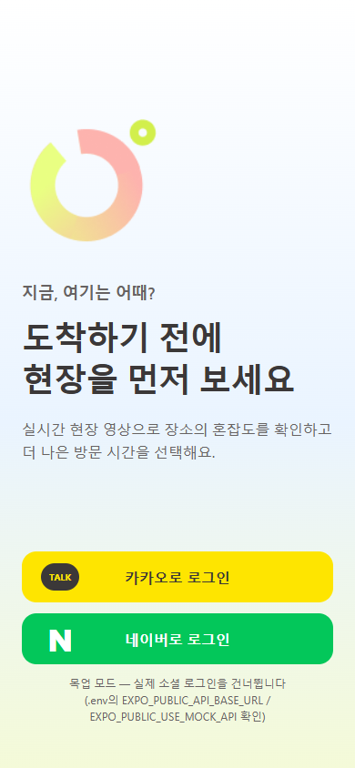 | 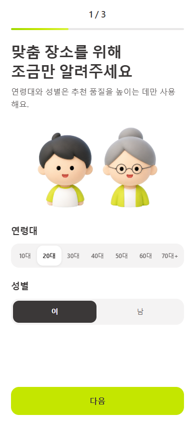 | 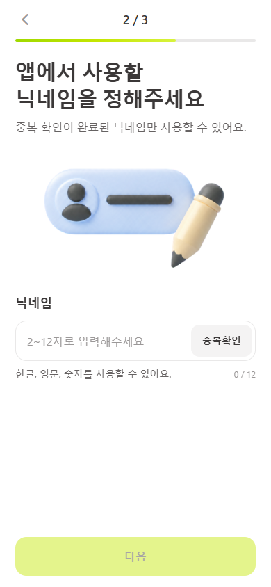 |

| 닉네임 중복 확인 | 선호 장소 선택 | 선호 순위 선택 완료 |
|---|---|---|
| 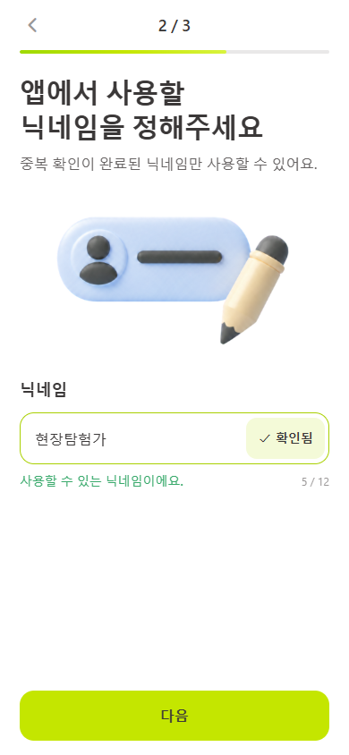 | 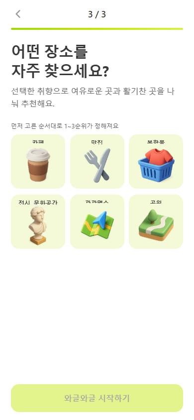 | 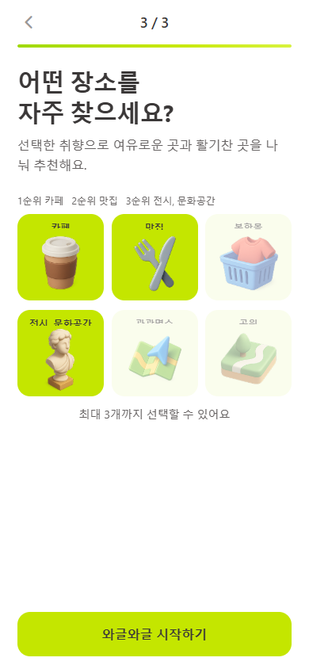 |

## 2. 홈·검색·장소

| 지도 홈 | 최근 검색 | 검색 결과 |
|---|---|---|
| 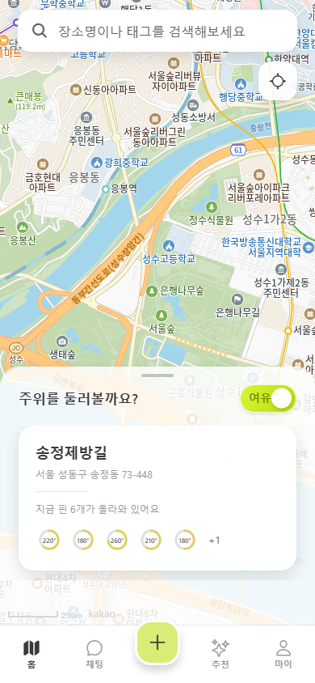 | 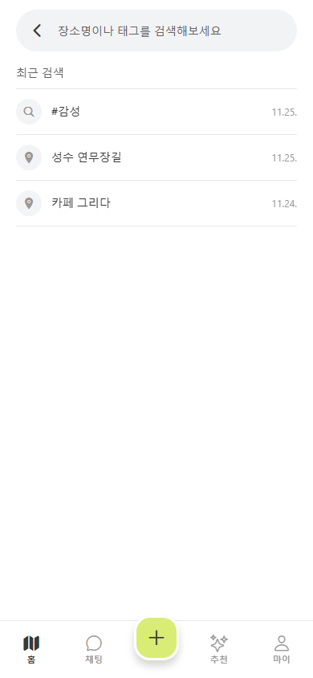 | 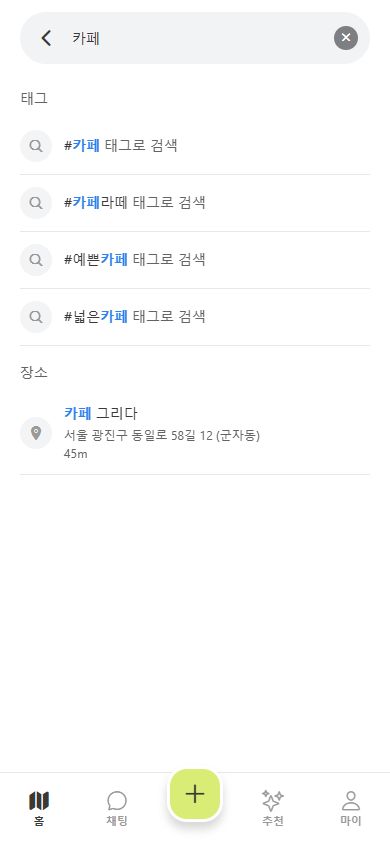 |

| 장소 상세·요일별 혼잡도 |
|---|
| 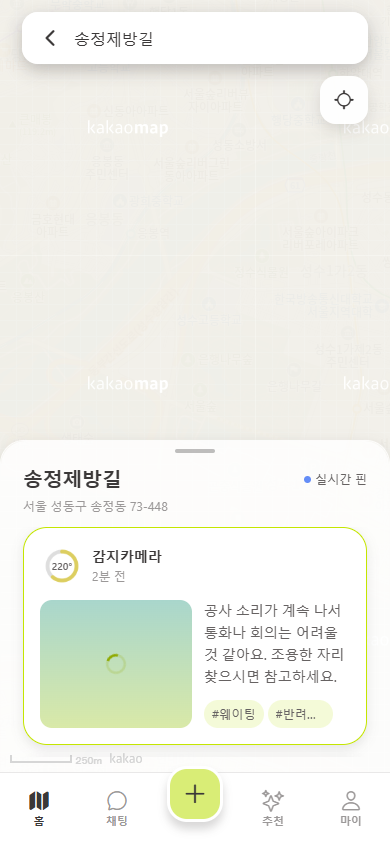 |

## 3. 영상핀 열람

| 결제 전 잠금 | 영상 열기 준비 | 결제 확인 |
|---|---|---|
| 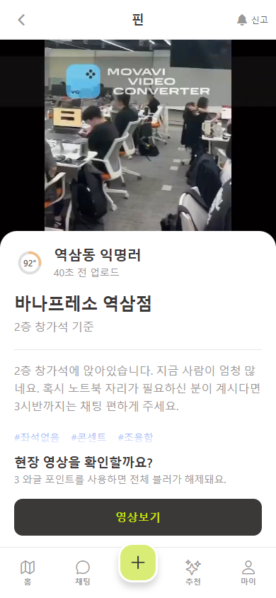 | 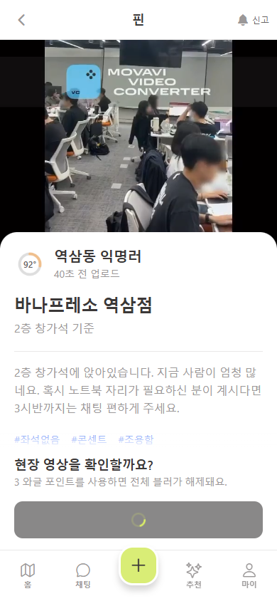 | 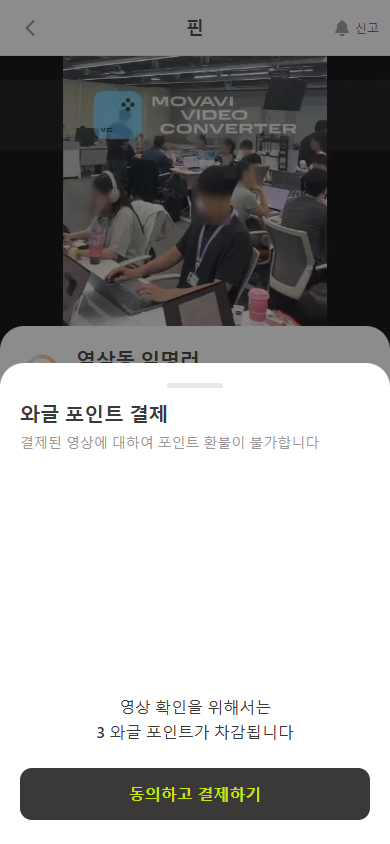 |

| 결제 후 영상·평가·채팅 |
|---|
| 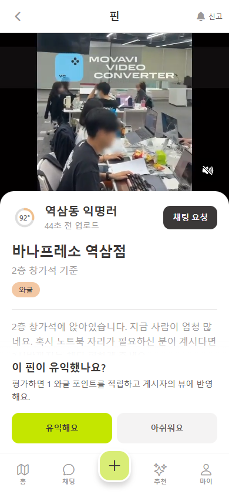 |

## 4. 추천·제보

| 여유로운 장소 추천 | 북적이는 장소 추천 | 핀 제보 작성 |
|---|---|---|
| 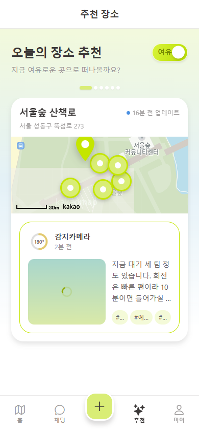 | 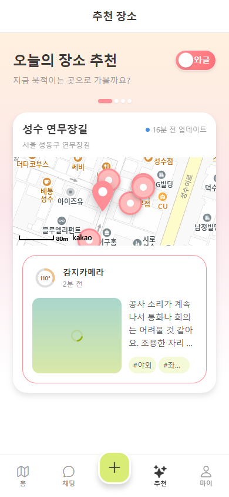 | 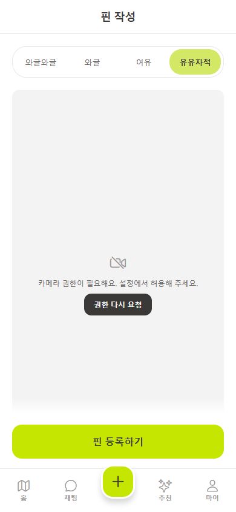 |

## 5. 실시간 채팅·AI 위험 감지

| 요청한 대화 | 요청받은 대화 | 핀별 채팅 요청 |
|---|---|---|
| 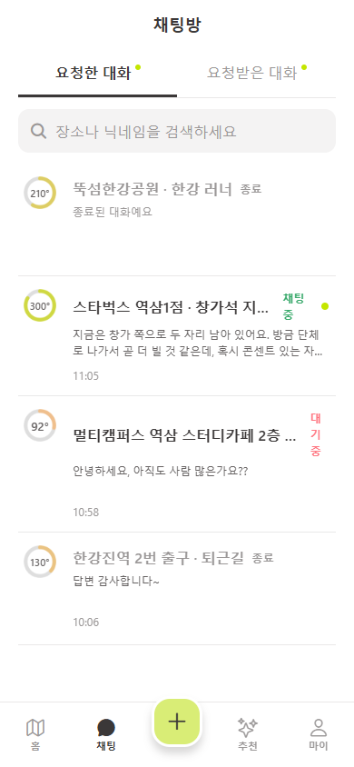 | 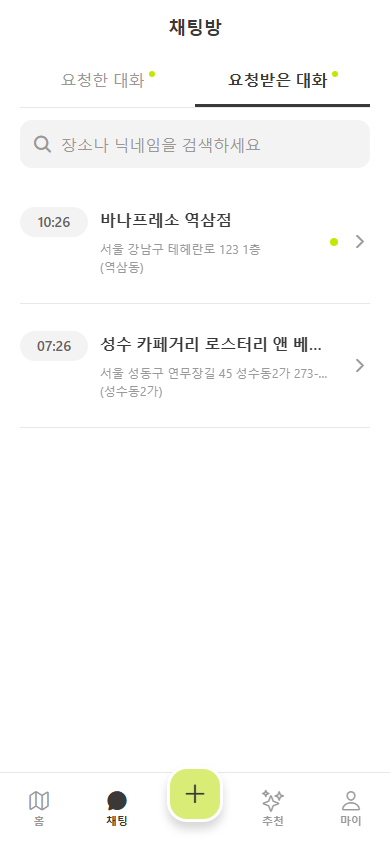 | 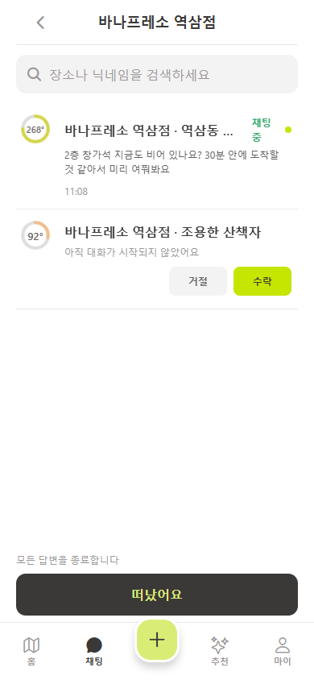 |

| 채팅방·누적 안전 경고 |
|---|
| 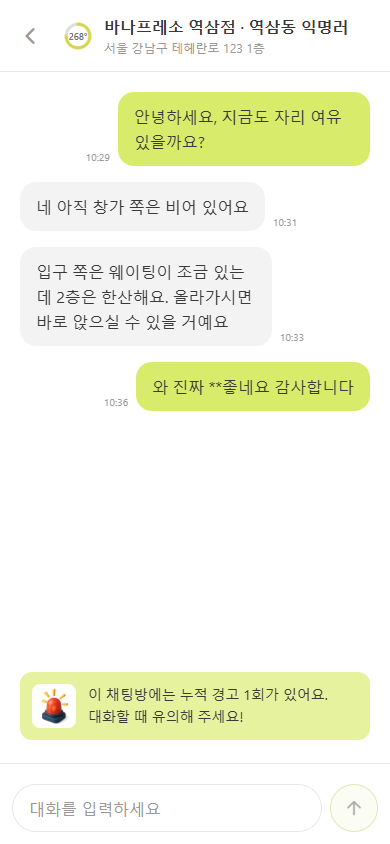 |

## 6. 마이페이지

| 신뢰도·활동 대시보드 | 오늘 작성한 핀 | 와글 포인트 내역 |
|---|---|---|
| 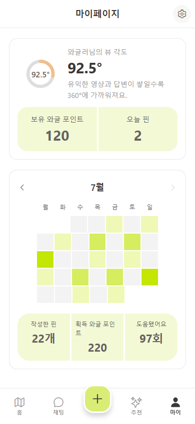 | 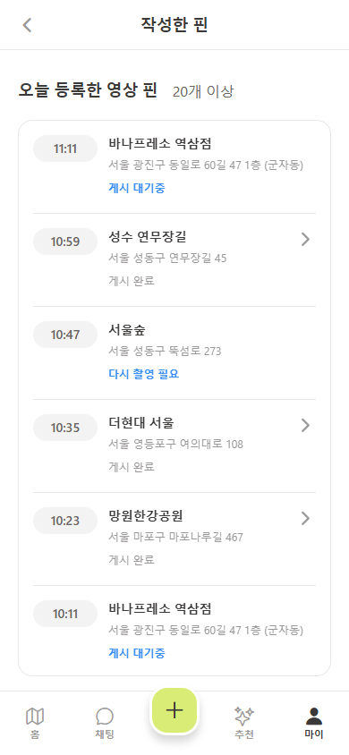 | 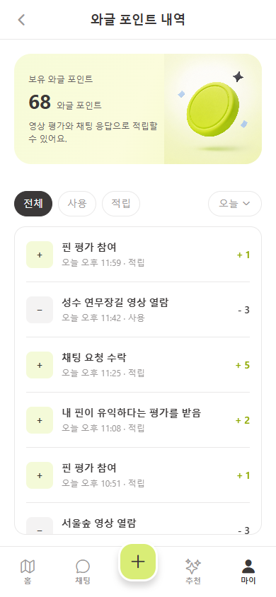 |

| 닉네임·선호 지역 수정 |
|---|
| 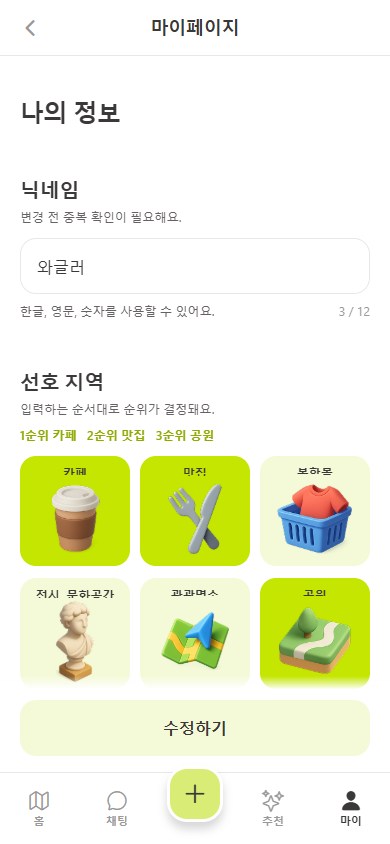 |

## 캡처 기준

- 해상도: 390×844
- 데이터: `EXPO_PUBLIC_USE_MOCK_API=true`의 고정 목업 시나리오
- 캡처 범위: 로그인 → 온보딩 → 지도 탐색 → 영상핀 결제 → 추천·채팅·제보 → 마이페이지
- 캡처일: 2026-11-25
